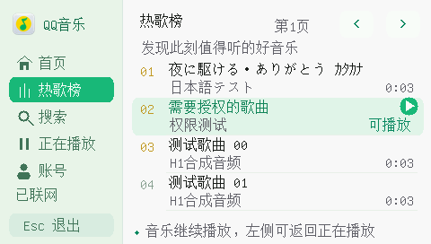

# BBK H1 · QQ音乐

面向步步高 **H1/Y100 V1.41** 的非官方 QQ音乐客户端，原生 480×272 界面。
H1 负责界面、账号、列表、歌词和 M4A 解复用；ESP32-S3 提供通用 Wi-Fi、HTTP 和 AAC 解码。
日常使用只需 H1、ESP 和电源，不需要电脑或 NAS 常驻。项目代码采用 GPL-3.0，第三方组件分别保留许可。

## 快速开始

当前版本 **0.1.11，预览版**。在发布完成前可以按下面命令构建 `dist/H1QQMusic.bda`；
发布后的成品在本仓库的 Releases 页面分发，下载 `H1QQMusic.bda` 或带目录的安装 ZIP。

1. 将 `H1QQMusic.bda` 放到 H1 的 **`A:\应用\程序\H1QQMusic.bda`**。
2. ESP USB1 经**带数据的软线 OTG（USB-C 公头→USB-A 母口）**接 H1 Mini-USB 数据线；USB2 单独供电。
   ESP 是 USB 主机，H1 是设备。不要把两个设备端直接互连。
3. ESP 使用通用固件 **0.4.4**，先用“H1 Wi-Fi设置”扫描并保存 2.4GHz 网络，再打开 QQ音乐。
   固件、板卡选型、J-OTG/供电及 Type-C CC 说明见 [H1 SDK ESP32 文档](https://github.com/HelloClyde/bbk-h1-bda-sdk/blob/63fa3c825feae5d9a1fa04572458fd5a5dbe847b/docs/esp32.md)。
4. 正常启动会自动停止兼容的 H1Debug 并软件重新枚举，不需要日常换线。
   仅支持已验证的 V1.41；启动时保持系统“USB连接”提示取消/否，交由应用使用 USB。

| 操作 | 按键或触屏 |
| --- | --- |
| 浏览/搜索 | H 热歌榜，S 原生中文/拼音搜索，上下选择、左右翻页；列表可上下拖动 |
| 点播/暂停 | Enter 点播，播放页空格/Enter/P 暂停或恢复；可点触按钮 |
| 音量/定位 | 上下调音量，左右前后10秒；触控进度条定位 |
| 上下首 | N 上一首、M 下一首；使用点播时捕获的本页队列，最多12首 |
| 模式 | B 或播放页右上按钮：顺序、列表循环、单曲循环、随机；真实结尾自动切歌 |
| 后台播放 | Esc 回列表，侧栏“正在播放”回到同一首；再按 Esc 退出并停止 |
| 登录 | A 账号，Q QQ扫码、W 微信扫码、R 刷新、L 退出登录 |

顺序播放到本页末尾停止；单曲循环仍允许手动换歌；随机模式避免连续重复并保留上一首历史。
自动切歌会跳过明确没有权限的歌曲，网络错误会停止并提示重试，不循环轰炸接口。
扫码须由用户在手机确认，是否有播放权限仍由上游返回，不能用登录绕过付费权限。
账号逻辑和 `A:\QQMusic.auth0/1` 均在 H1；ESP 不保存音乐账号。
播放模式存于 `A:\QQMusic.cfg`，正常退出时写入。更新 BDA 不需要删除这三个文件。
不要公开分享账号文件。封面、歌词和歌曲只在运行时请求，仓库和安装包不内置歌曲或用户凭据。

### 从源码构建

目前完整复现流程在 **Windows x64、Python 3.12、GNU MIPS 15.2.0** 上验证。
工具链安装脚本带固定下载 SHA-256；也可通过 `H1_GNU_BIN` 指向相同版本的已有工具链。

```powershell
git clone --recurse-submodules https://github.com/HelloClyde/BBKH1-QQMusic.git
cd BBKH1-QQMusic
git submodule update --init
python -m pip install -r requirements-build.txt
python tools/install_gnu_toolchain.py
$env:H1_GNU_BIN = (Resolve-Path .tools/toolchain/bin).Path
python tools/build_h1_qqmusic.py --all
python tools/package_release.py
```

正式版为 `dist/H1QQMusic.bda`，调试邮箱版为 `dist/H1QQMusicDbg.bda`；日常只安装正式版。
`dist/release/` 包含正式 BDA、正确安装目录的 ZIP、构建信息和 SHA256SUMS。
不会自动刷 ESP、上传 H1 或读取本机账号。构建采用相对路径、固定时间和稳定归档顺序。
预生成的点阵字库及原始 HEX、图标母版及打包脚本一并提供，不依赖本机商业字体或图像服务。

```powershell
python -m pip install -r requirements-test.txt
python tools/test_h1_qqmusic_modes.py
python tools/test_h1_qqmusic_buffer.py
python tools/test_h1_qqmusic_navigation.py
```

以上是实际链接 MIPS 程序和真实合成 AAC 解码测试，固件游标/输入/HTTP 为明确模型边界；不需要串口。
独立的 Range/预取协议检查可运行 `python tools/test_h1_qqmusic_stream.py`，需 `HOST_CC` 或 PATH 中的 gcc。

## 截图


物理 H1 0.1.11 首页，安装观察阶段、尚未完成 USB 交接，不作为联网或持续播放证明。




播放页和列表来自实际链接 MIPS 应用的480×272截图；使用本项目自制音频、合成封面和测试歌曲。
没有将效果图、真实用户歌单或真实扫码凭据当作运行证据。

## 依赖

成品：H1/Y100 **V1.41**、有 PSRAM 的 ESP32-S3、通用固件0.4.4、数据 OTG线和独立电源。
原生USB驱动按V1.41验证，不支持把本包直接用于未知系统版本；ESP32-S3只支持2.4GHz。

构建：H1 SDK 子模块 `sdk/` 固定 **`067fe072477861dfc8949d7b1a55279fb92d2548`**，
来源 [MrDefinition1999/bbk-h1-bda-sdk](https://github.com/MrDefinition1999/bbk-h1-bda-sdk)。
沿用应用实际验证版本；通用固件/配网文档的新SDK fork独立发布，不悄悄升级本应用ABI。
其余源码依赖：FFmpeg0.6.7（本应用使用MOV解复用）、musl1.2.5、TLSF3.1、cJSON、
libpng1.6.43、zlib1.3.1、IJG JPEG9f、GNU Unifont16.0.04及原生输入所用Noto映射表。
依赖源码、原许可与来源见 [THIRD_PARTY.md](THIRD_PARTY.md)。
Python依赖在两个 requirements 文件中固定；仅测试需要 Unicorn/PyAV，成品不依赖电脑后端。

## 验证范围与限制

见 [验证记录](docs/VERIFICATION.md)。已记录真机安装、原生USB接管、既有扫码/后台播放及韩文显示反馈；
0.1.11的约90秒短停改动、自动下一首和四模式的最终实体试听仍待确认。
本版提前建立HTTP分段并储备已解码PCM，不把模型的等待时间直接称作真机提速。
搜索/播放接口可能变更；提供C400标准M4A/AAC，不含个人歌单、收藏写入、无损、MV或QRC逐字歌词。
扫码支持QQ/微信，但未将两种方式都写成已完成实体账号验收。

## 感谢

- HelloClyde 的 [Tesla Media Center](https://github.com/HelloClyde/tesla-media-center)，
  固定参考 `9d7cb51cf5ddf3e02fa8d6e1c129168d11af4aae`，参考权限、队列、歌词和扫码流程。
  上游GPL-3.0、文件指纹保留在 `h1-qqmusic/tmc-reference.json`。
- MrDefinition1999 的 H1 BDA SDK，以及 H1 原生接口研究和硬件测试参与者。
- FFmpeg、Rich Felker及musl贡献者、Matthew Conte/TLSF、Dave Gamble/cJSON、
  libpng、zlib、IJG、Roman Czyborra、Paul Hardy和Unifont贡献者、Adobe/Noto贡献者。

QQ音乐名称、标志及上游内容属于各自权利人。本项目是非官方开源实验客户端，不代表腾讯或步步高。
许可详情见 [LICENSE](LICENSE)、[THIRD_PARTY.md](THIRD_PARTY.md)。
